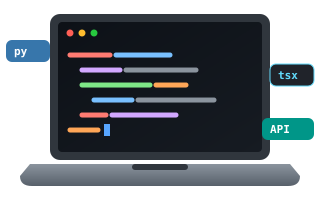

<h1 align="center">Hi 👋 I'm Karthik</h1>

  <b>CS Student • Open Source Developer • Builder</b>

---

### 🔗 About Me

<table>
  <tr>
    <td width="30%" align="center" valign="middle">
      
    </td>
    <td valign="middle">
      <b>Hey there! I'm Karthik</b>
      
I'm a computer science student at ANITS, Visakhapatnam, building at the intersection of agentic AI, machine learning, and full-stack engineering.

      
I'm learning about multi-agent systems, LLM architecture, and RAG pipelines while building useful tools and open-source projects.

      
<b>⚙️ Tech Stack:</b> 
        
        
        
        
        
      

    </td>
  </tr>
</table>

---

### 🔗 Top Projects (built to solve real problems)

<table>
  <tr>
    <td valign="middle">
      <ul>
        <li><b><a href="https://github.com/MKarthik730/cognitus">COGNITUS</a></b> — A multi-agent AI system where domain-expert agents analyze a problem from different perspectives and combine their findings into a clear verdict. 
        <code>TypeScript</code> <code>Next.js</code> <code>Claude API</code> <code>LangGraph</code></li>
         
        <li><b><a href="https://github.com/MKarthik730">VOID</a></b> — A self-hosted, local-first AI workspace for chat, agents, research, documents, email, notes, calendar, and local model workflows. Your models, your data, and no cloud dependency. 
        <code>Python</code> <code>FastAPI</code> <code>Local AI</code></li>
         
        <li><b><a href="https://github.com/MKarthik730/Memoir">MEMOIR</a></b> — A web app for preserving and visualizing personal relationships and shared memories. 
        <code>React</code> <code>FastAPI</code> <code>PostgreSQL</code> <code>D3.js</code></li>
      </ul>
    </td>
    <td width="25%" align="center" valign="middle">
      
    </td>
  </tr>
</table>

---

### 🔗 Connect

  
  
  
  
  

> Building is a process. Every project teaches me something new, and every commit is a step forward.

---

### 🔗 Contribution

  

---

### 📌 Currently

- 🎓 Third-year CS student at ANITS, Visakhapatnam
- 🤖 Learning multi-agent systems, LLM architecture, and RAG pipelines
- 🛠️ Building AI tools and full-stack applications
- 🤝 Open to collaboration on ML and full-stack projects
- 💼 Open to internship opportunities
